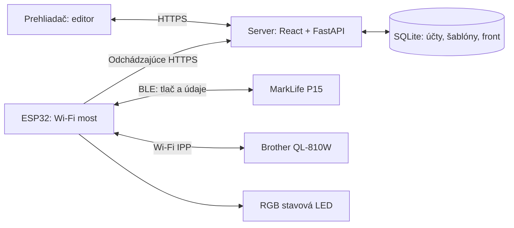
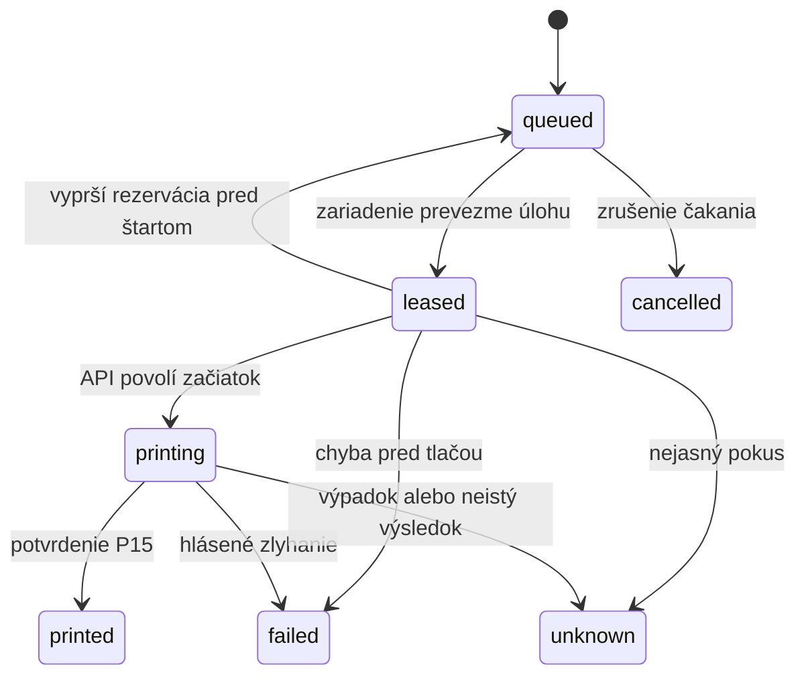

# Fajny Print Studio

Vlastná webová aplikácia na tvorbu a tlač štítkov **MarkLife P15 a Brother QL-810W**. Štítok pripravíš v prehliadači, server ho uloží do frontu a ESP32 ho odošle P15 cez Bluetooth alebo Brotheru cez Wi-Fi. Mobilná aplikácia výrobcu nie je potrebná.

Aktuálna implementácia používa **ESP32 ako most pre BLE aj sieťovú tlač IPP**. Pôvodný návrh s Raspberry Pi bol nahradený ESP32; hotový RPi agent nie je súčasťou repozitára.

## Dokumentácia

| Čo potrebuješ | Návod |
|---|---|
| Aktualizácia firmvéru ESP32 cez Wi-Fi | [Wi-Fi aktualizácie](docs/OTA.md) |
| Brother QL-810W, rolky, IPP a nastavenie ESP32 | [Brother návod](docs/BROTHER.md) |
| Textový alebo QR štítok, šablóny a účty | [Používanie štúdia](docs/USER_GUIDE.md) |
| Malý 0,91″ OLED, zapojenie a aktuálne stavy ESP32 | [OLED displej](docs/OLED.md) |
| Odľahčená Brother gateway v existujúcom ESPHome zariadení | [ESPHome gateway](docs/ESPHOME.md) |
| Farby, intervaly blikania, zapojenie a test LED | [Stavová RGB LED](docs/LED.md) |
| Server, Docker, HTTPS a zálohy | [Nasadenie a správa](docs/DEPLOY.md) |
| Zostavenie ESP32, Wi-Fi a pripojenie P15 | [ESP32 firmvér](firmware/README.md) |
| Komunikácia, tlačový front a ochrana pred opakovaním | [Architektúra](docs/ARCHITECTURE.md) |
| Offline zariadenie, chyba tlače či prihlásenia | [Riešenie problémov](docs/TROUBLESHOOTING.md) |
| API, raster a telemetria | [API](api/README.md) |
| Rozsah overenia | [Kontroly projektu](docs/ACCEPTANCE.md) |

## Ako to funguje



1. V editore pripravíš text alebo QR a skontroluješ skutočný serverový náhľad.
2. Server uloží raster a úlohu do trvalého frontu. Každá kópia má samostatnú úlohu.
3. Cieľové ESP32 sa približne každých 10 sekúnd pýta servera na prácu.
4. Po kontrole rastra a povolení servera ESP32 pripojí P15 cez BLE a prenesie štítok.
5. Výsledok odošle späť serveru. Neistá tlač sa automaticky neopakuje.

Každé ESP32 môže byť v inej LAN. Zariadenia iniciujú spojenia smerom von; na domácom routeri netreba otvárať prichádzajúci port. Počas nastavovania ESP32 vytvorí vlastný miestny Wi-Fi portál.

## Funkcie

| Oblasť | Možnosti |
|---|---|
| Profil | 40 × 12 mm, čiernobiela termotlač, náhľad 320 × 96 bodov |
| Text | Najviac 200 znakov a 4 riadky, automatická alebo pevná veľkosť |
| Fonty | DejaVu Sans, Sans Bold, Serif, Sans Mono a pixelové písmo 5 × 7 |
| Formátovanie | Zarovnanie, tučné, kurzíva, podčiarknutie, medzery, rámik, inverzia |
| Symboly | Čiernobiele symboly a vybrané emotikony; nepodporované znaky sa odmietnu |
| QR | Text alebo odkaz, voliteľný popis vedľa QR, živý náhľad a kontrola čitateľnej veľkosti |
| Šablóny | Uloženie obsahu a štýlov vrátane QR |
| Front | 1–10 kópií, história, zrušenie čakajúcej úlohy, čakanie na offline most |
| Zariadenia | Viac ESP32, vlastný kľúč pre každý most, výber cieľa tlače |
| Telemetria | Skutočne načítaný model, verzia, sériové číslo, batéria a stav P15; údaje mosta |
| Účty | E-mail, heslo, prezývka, správcom riadená registrácia, spoločný front a šablóny |

Pixelové písmo používa veľké ASCII znaky a nepodporuje diakritiku. Pre slovenčinu vyber TrueType font. QR má vlastné rozloženie. Jeho voliteľný popis používa zvolené písmo a textové štýly; samotný kód zostáva čierny na bielom.

## Stavová LED ESP32

Firmvér 2.0.0 ovláda **externú adresovateľnú RGB LED WS2812/NeoPixel na GPIO18**. Nejde o univerzálne ovládanie vstavanej kontrolky ľubovoľnej dosky.

| Farba | Svieti / nesvieti | Význam |
|---|---|---|
| 🔵 Modrá bliká | 500 / 500 ms | Otvorený nastavovací Wi-Fi portál |
| 🟡 Žltá bliká | 300 / 300 ms | Wi-Fi, synchronizácia času alebo komunikácia s API |
| 🟢 Slabá zelená | Trvalo | Úspešný kontakt so serverom; pripravenosť mosta |
| 🟣 Fialová bliká | 500 / 500 ms | Vyhľadávanie a pripájanie k P15 |
| 🟣 Fialová svieti | Počas kroku | BLE spojenie je nadviazané |
| Tyrkysová bliká | 150 / 150 ms | Prenos štítku a čakanie na potvrdenie |
| 🟢 Jasná zelená bliká | 100 / 100 ms počas 1 s | P15 potvrdila prenos |
| 🔴 Červená bliká | 250 / 250 ms | Chyba komunikácie, úložiska alebo neistý výsledok |

Krátka žltá sa môže objavovať aj pri bežnej kontrole frontu. Fialová sa používa aj pri čítaní údajov P15 bez tlače. Zelená pripravenosť neznamená trvalé BLE spojenie ani záruku prítomnosti papiera. Kompletné priority stavov, zapojenie a 12-sekundový `LED_TEST` sú v [LED návode](docs/LED.md).

## Čo potrebuješ

- MarkLife P15 a štítky zodpovedajúce profilu 40 × 12 mm.
- ESP32 s BLE a Wi-Fi; profil je `esp32dev`, pôvodný ESP32-D0WDQ6 so 4 MB flash.
- USB dátový kábel, napájanie a 2,4 GHz Wi-Fi.
- Voliteľne RGB modul WS2812/NeoPixel podľa [návodu](docs/LED.md).
- Server s Docker Compose, HTTPS doména a reverzná proxy.
- PlatformIO a Python s `pyserial` na prvotné nastavenie ESP32.

ESP32-C3, iné tlačiarne, rozmery štítkov a RGBW LED nie sú týmto profilom automaticky podporované; vyžadujú prispôsobenie a overenie.

## Prvé spustenie

```sh
git clone https://github.com/pidiman/stitky.git
cd stitky
cp .env.example .env
```

1. Do `.env` nastav dva **rôzne náhodné kľúče** `ADMIN_TOKEN` a `AGENT_TOKEN`, každý aspoň 24 znakov; odporúčané sú 32 a viac. Nastav `PUBLIC_ORIGIN` na svoju HTTPS adresu.
2. Spusti `docker compose up -d --build`. Služba je predvolene iba na `127.0.0.1:8094`; pripoj HTTPS proxy podľa [nasadenia](docs/DEPLOY.md).
3. Pri čerstvej databáze sa prihlás **admin / admin** a nastav e-mail, prezývku a nové heslo s aspoň 10 znakmi. Potom sa prihlasuješ e-mailom.
4. Zostav a nahraj ESP32 podľa [firmvérového návodu](firmware/README.md). Nastav HTTPS API, kľúč zariadenia, koreňový CA certifikát a **skutočnú MAC vlastnej P15**.
5. Pripoj sa k `P15-Setup-…`, otvor `http://192.168.4.1` a nastav svoju 2,4 GHz Wi-Fi. Názov a náhodné heslo nastavovacej siete ukáže USB výpis.
6. Keď je most online, priprav štítok, skontroluj náhľad, vyber zariadenie a použi tlačidlo tlače.

`labels.example.com`, `MyWiFi` a MAC v príkladoch sú vzory. Nahraď ich vlastnými hodnotami. Produkčné nastavenia, databázy a heslá patria mimo Gitu.

## Účty

Prvý účet je správca a musí dokončiť úvodné nastavenie. Registrácia ďalších účtov je predvolene vypnutá. Zapína ju správca v **Môj účet → Registrácia účtov**. Bežný používateľ nemôže meniť registráciu ani vytvárať zariadenia.

Používatelia v tomto MVP zdieľajú front a šablóny. Relácia má platnosť 12 hodín a používa zabezpečenú cookie; web preto potrebuje HTTPS. Projekt neobsahuje odosielanie obnovovacích e-mailov ani samoobslužnú obnovu zabudnutého hesla.

## Tlač a neisté výsledky



`printed` znamená potvrdenie AA/OK od tlačiarne, nie optické overenie štítku. Pri `unknown` najprv fyzicky skontroluj výtlačok. ESP32 si rozpracovaný výsledok pamätá v NVS a po výpadku neopakuje tlač len preto, že sa nepodarilo doručiť výsledok serveru.

## Štruktúra projektu

```text
web/                 React + TypeScript editor
api/                 FastAPI, účty, rendering, SQLite a testy
firmware/src/        ESP32, Wi-Fi portál, BLE, LED a telemetria
firmware/tools/      USB provisioning a hostiteľské testy
firmware/certs/      Verejný koreňový certifikát HTTPS
docs/                Používanie, architektúra, LED, nasadenie a diagnostika
compose.yaml         Prenosné nasadenie s portom na loopback
compose.oracle.yaml  Voliteľná sieť web a príkladová Tailscale adresa
Dockerfile           Spoločný obraz API a zostaveného webu
```

## Vývoj a overenie

```sh
python3 -m venv .venv
.venv/bin/pip install -r api/requirements-test.txt
.venv/bin/python -m pytest -q api firmware/tools/test_provision.py
npm --prefix web ci
npm --prefix web run build
```

Mimo Dockera nainštaluj aj fonty DejaVu. Hostiteľské C++ kontroly a zostavenie firmvéru sú v [ESP32 návode](firmware/README.md). Posledná kontrola zdrojového stavu zahŕňala 188 testov API/provisioningu a konfigurácie Brothera a zostavenie webu. Dokumentačné úpravy samy nespúšťajú tlač ani nahratie firmvéru.

MVP podporuje P15 40 × 12 mm a štyri Brother profily: 29/62 mm súvislú pásku s dĺžkou 20–200 mm, 29 × 90 mm a 62 × 100 mm. Brother používa 300 dpi, monochromatickú tlač a voliteľný automatický orez. Rozšírenie vyžaduje firmvér ESP32 1.3.2; prvé nahratie cez USB. Tlač zo štúdia cez ESP32 do Brother QL-810W bola 17. 11. 2026 úspešne fyzicky overená na 29 mm súvislej rolke vrátane QR kódu s popisom (server 0.3.1, firmvér 1.3.2). Detaily a rozsah overenia sú v [Brother návode](docs/BROTHER.md). Všeobecné obrázky, iné médiá, dvojfarebná tlač, oddelené priestory používateľov a hotový RPi agent nie sú súčasťou tejto verzie.

Od servera 0.4.0 a firmvéru 2.0.0 je dostupná aktualizácia ESP32 cez Wi-Fi priamo v samostatnej sekcii **Aktualizácie**. Staršie ESP32 potrebuje jednorazovú USB migráciu na dve aplikačné partície; ďalšie aktualizácie už prebiehajú zo štúdia. [Postup a limity](docs/OTA.md).

Sekcia **Aktualizácie** kontroluje najnovšie stabilné vydanie firmvéru na GitHube a ponúka jeho inštaláciu jedným tlačidlom. `.bin` aj kontrolný manifest publikuje automatické zostavenie; súbor už netreba ručne vyhľadávať a nahrávať. [Postup a vydania firmvéru](docs/OTA.md).

Firmvér **2.1.0** pridáva voliteľný OLED SSD1306 128 × 32 cez I²C (SDA GPIO21, SCK/SCL GPIO22, VCC 3V3). Od **2.1.1** ponecháva druhý riadok prázdny a zobrazuje iba činnosť a podstatný detail bez striedania diagnostických údajov. [Zapojenie, predpokladaný modul a diagnostika](docs/OLED.md).
