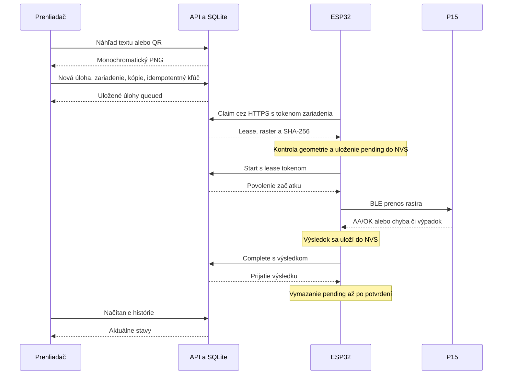

# Architektúra a komunikácia

[Späť na projekt](../README.md) · [API](../api/README.md) · [Nasadenie](DEPLOY.md)

## Komponenty

| Komponent | Úloha |
|---|---|
| React + TypeScript + Vite | Editor, náhľad zo servera, šablóny, front, zariadenia a účty |
| FastAPI + Pillow + qrcode | Autentifikácia, rendering, trvalý front, telemetria |
| SQLite WAL | Účty, relácie, nastavenia, zariadenia, šablóny, úlohy a uložené rastre |
| ESP32 Arduino/PlatformIO | Wi-Fi portál, HTTPS polling, NVS zotavenie, BLE P15 a RGB LED |
| MarkLife P15 | Fyzický príjem rastra, termotlač a odpovede na podporované dotazy |
| HTTPS reverzná proxy | TLS pre prehliadač a zariadenia; príklad Caddy |

Docker zostaví web a vloží ho do obrazu API. FastAPI obsluhuje statické súbory aj `/api/`; web a API teda môžu mať rovnaký pôvod. Kontajner používa neprivilegovaného používateľa UID 10001 a trvalý dátový volume.

## Prenos štítku

## Geometria a rendering

Používa sa pevný profil 40 × 12 mm. Náhľad má 320 × 96 bodov. Pre tlač sa otočí doprava na 96 × 320 bodov a zabalí MSB-first, čierny bod = 1. Raster má presne **3840 bajtov**. ESP32 overuje rozmery, veľkosť a SHA-256 pred tlačou.

Text vykresľuje server s DejaVu alebo autorským pixelovým fontom. QR používa ten istý výstupný obraz a raster. Pri zmene UI alebo fontu sa už uložený raster existujúcej úlohy neprekresľuje.

## Rezervácia a prevencia duplicít

Rezervácia úlohy trvá **90 sekúnd**. Prebratie a začiatok sú transakčné. Súbežné požiadavky nemajú spustiť tú istú úlohu dvakrát.

- Pred začiatkom môže expirovaná rezervácia bezpečne vrátiť úlohu do queued.
- Start sa spotrebuje iba raz; opakovaný štart sa odmietne.
- Po začatí výpadok vedie k unknown, nikdy automaticky späť do queued.
- ESP32 zapisuje pending do NVS pred pokusom. Reštart nespúšťa nový fyzický pokus pôvodnej úlohy.
- Neodoslaný výsledok sa opakuje voči API bez opakovania BLE tlače.
- Nejasný výsledok musí posúdiť človek podľa fyzického štítku.

Server expirácie spracúva pri operáciách s frontom; nepoužíva samostatný plánovač. Idempotentný kľúč bráni vytvoreniu duplicít pri opakovanej rovnakej požiadavke. Každá požadovaná kópia má vlastné ID.

## BLE a HTTPS v ESP32

Most medzi požiadavkami uvoľňuje TLS/HTTP objekty a po BLE operácii uvoľní spojenie. Znižuje tým tlak na pamäť pôvodného ESP32.

| Parameter | Hodnota |
|---|---|
| Kontrola frontu | Približne každých 10 s, ak je zariadenie pripravené |
| Telemetria mosta | Približne každých 30 s mimo tlače/pending/portálu |
| Nové čítanie P15 | Pri štarte na prázdnom fronte a na vyžiadanie, najviac raz za 60 s |
| BLE služba | FF00 |
| Prenos / odpovede / kredity | FF02 / FF01 / FF03 |
| Dátový blok | Najviac 20 bajtov, odstup aspoň 30 ms, riadenie kreditmi |
| Čakanie na potvrdenie tlače | Do 15 s po odoslaní |
| NVS | Oddelené nastavenia mosta a rozpracované výsledky |

Časy sú softvérové intervaly a timeouty, nie sľub celkovej rýchlosti tlače.

## Účty, kľúče a dôvera

Používateľské heslá sa hashujú cez Argon2; neprenášajú sa do ESP32. Používateľská relácia má náhodný token v Secure/HttpOnly/SameSite=Lax cookie, server ukladá jeho hash a kontroluje CSRF pri zmene údajov.

Každý most má vlastný bearer token. Nemôže preberať úlohy iného mosta. Prvý token zariadenia sa synchronizuje z prostredia servera; ďalšie zariadenia sa vytvárajú cez administrátorské rozhranie.

`ADMIN_TOKEN` je oddelený údržbový kľúč, nie heslo do webu. Obmedzuje ho `MAINTENANCE_CIDRS`. `PUBLIC_ORIGIN` určuje očakávaný pôvod webových požiadaviek.

ESP32 overuje HTTPS cez uložený koreňový CA certifikát; nemá insecure TLS režim. Pred HTTPS čaká na synchronizovaný čas. Bežná prevádzka potrebuje odchádzajúce DNS, NTP a HTTPS; miestna P15 sa pripája cez BLE.

## Údaje o tlačiarni

Heartbeat mosta neobnovuje čas posledného čítania P15. Dotaz na model, verziu, sériové číslo, batériu a stav prebieha samostatne. Nové čítanie bez batérie/stavu tieto premenlivé údaje zneplatní, aby sa nezobrazovali ako čerstvé. Stabilná identita môže zostať zachovaná s poctivým časom overenia.

Dotazy na informácie samy neposielajú tlač, posun papiera ani kalibráciu. Nezistené údaje sa označujú ako nedostupné; systém si ich nevymýšľa.

## Úložisko a rozšírenie

Záloha SQLite obsahuje aj účty, relácie, tokenové hashe, šablóny a front, preto je súkromná. Za behu použi SQLite backup API, nie samostatné kopírovanie databázy bez WAL. Obnova a aktualizácia sú v [nasadení](DEPLOY.md).

Viac lokalít znamená ďalšie ESP32 s vlastným tokenom, Wi-Fi a cieľovou P15. Nie je potrebné meniť centrálny princíp frontu. Podpora inej tlačiarne alebo geometrie však vyžaduje zmenu renderingového aj firmvérového profilu; nestačí premenovať zariadenie.
